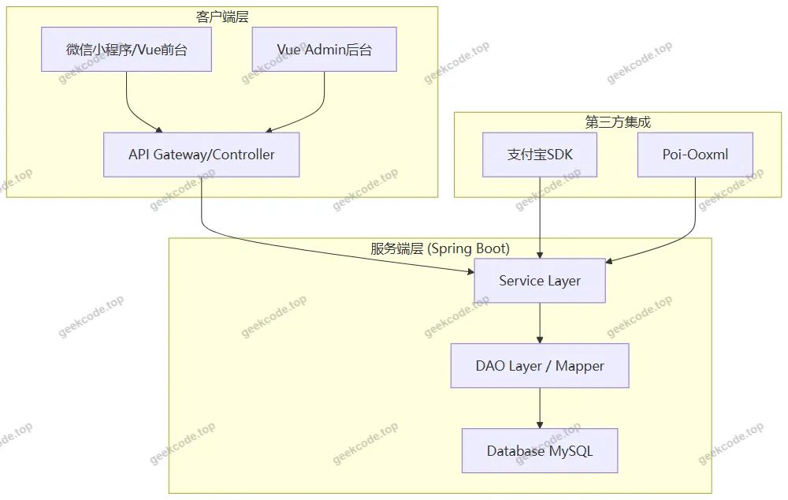
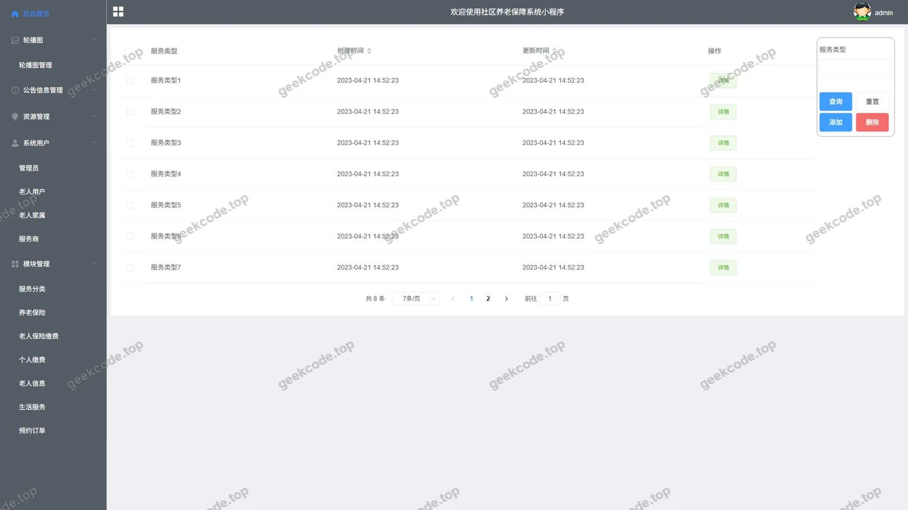
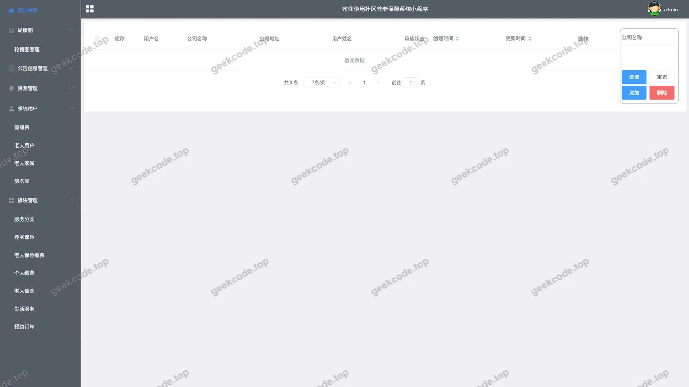
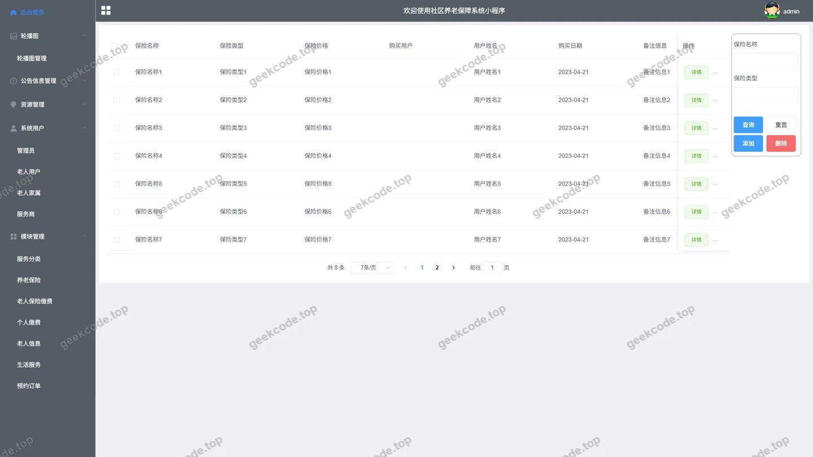
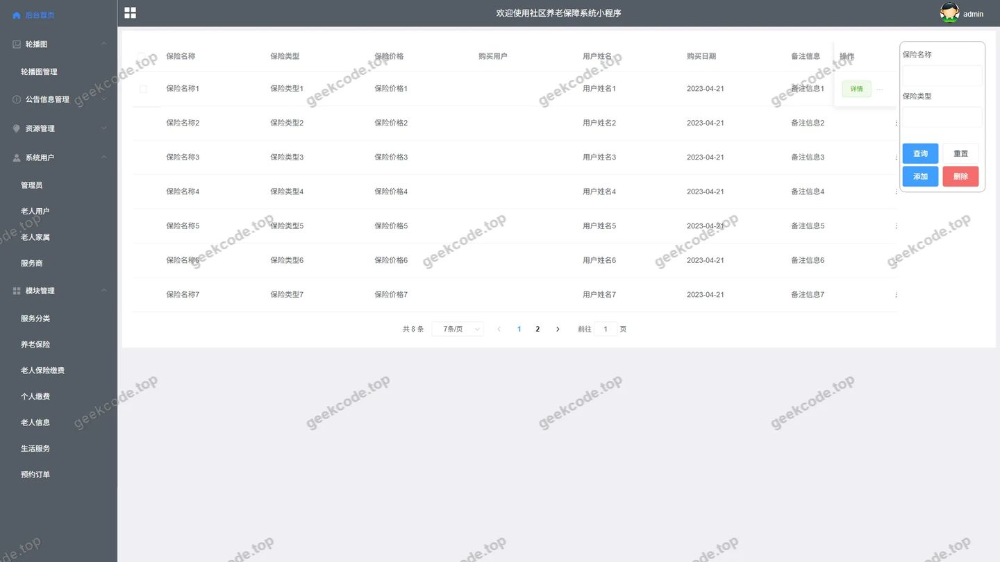
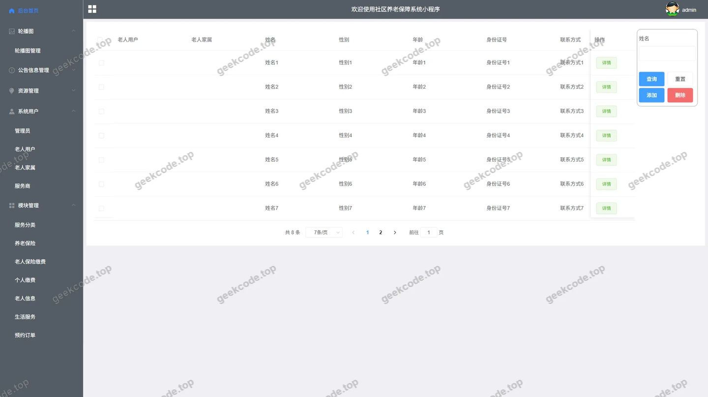
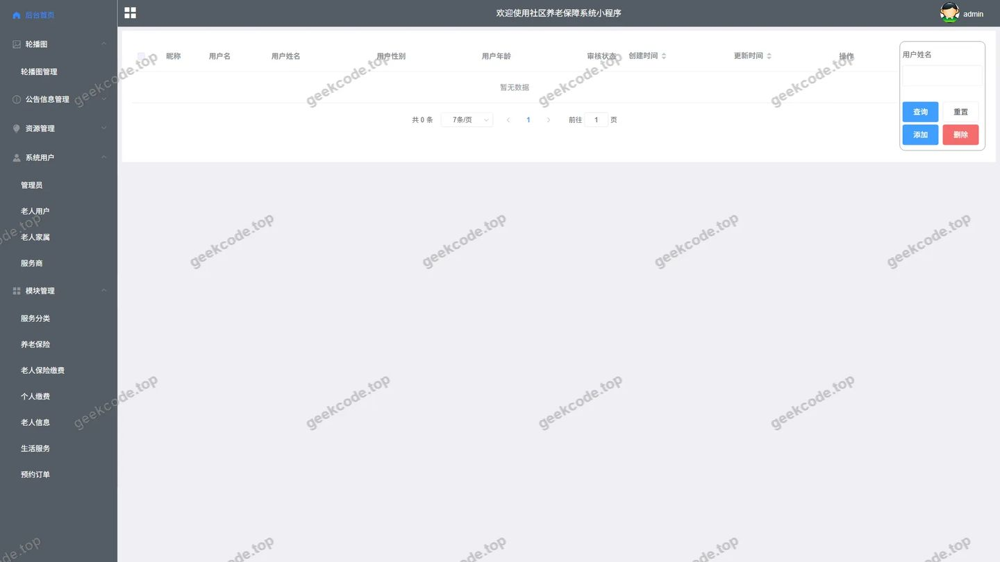
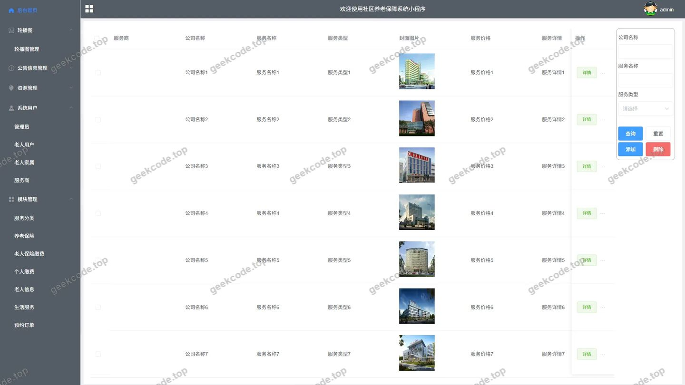
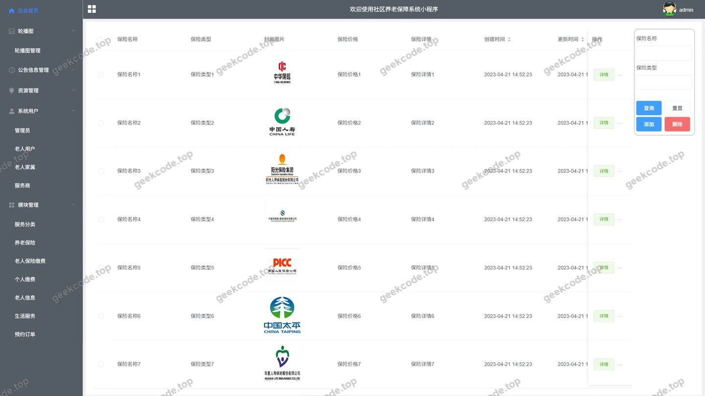
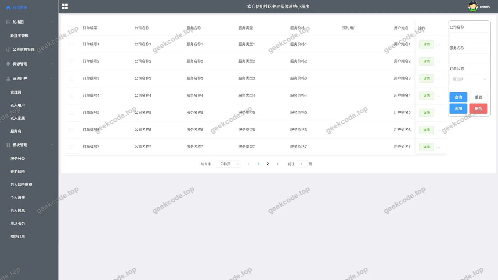

# spring boot社区养老保障系统小程序

> 🎓 **计算机毕业设计 · spring boot社区养老保障系统小程序**
>
> 本仓库只放**项目介绍 + 运行截图**（截图是站点带水印的原图，存在仓库 `images/` 里）。
>
> 👉 **完整可运行源码 / 数据库脚本 / 部署文档：[点我获取](https://geekcode.top/archives/spring-boot%E7%A4%BE%E5%8C%BA%E5%85%BB%E8%80%81%E4%BF%9D%E9%9A%9C%E7%B3%BB%E7%BB%9F%E5%B0%8F%E7%A8%8B%E5%BA%8F?utm_source=github)**
>
> 💬 咨询微信：**ir9372**　|　🌐 更多项目：[极客代码 geekcode.top](https://geekcode.top/?utm_source=github)
>
> 📌 项目详情页：<https://geekcode.top/archives/spring-boot%E7%A4%BE%E5%8C%BA%E5%85%BB%E8%80%81%E4%BF%9D%E9%9A%9C%E7%B3%BB%E7%BB%9F%E5%B0%8F%E7%A8%8B%E5%BA%8F?utm_source=github>

<table><td width="230" align="center"> <b>扫码加微信 ir9372</b></td><td valign="middle">📦 源码 = 项目介绍 + 全部运行截图 + 数据库 + 部署文档 👉 点上方任意截图，直接跳到 <b>极客代码 geekcode.top</b> 详情页</td></table>

---

<h1>spring boot社区养老保障系统小程序</h1>
<h2>项目概述</h2>

本项目为社区养老保障系统小程序，旨在利用数字化手段优化社区养老服务流程，提升养老资源的管理效率与服务质量。系统核心功能涵盖老人信息管理、养老保险缴纳、生活服务预约及服务商管理等多个维度，适用于社区养老机构、政府民政部门及相关服务供应商。技术架构采用前后端分离模式，后端基于 Spring Boot 框架构建 RESTful API，集成 MyBatis-Plus 实现高效数据持久化；前端采用 Vue 框架开发，提供用户交互界面与管理后台操作平台。通过整合线上预约、缴费与服务对接，解决传统养老模式中信息不对称、流程繁琐等痛点，实现养老服务的智能化与便捷化。

<h2>技术架构</h2>
<h3>1. 总体架构设计</h3>

系统采用经典的前后端分离架构（Vue-Separate），确保了高内聚低耦合的开发模式。

<h3>2. 核心技术选型理由</h3>
<ul>
<li><strong>后端框架</strong>：选用 <code>spring-boot-starter-web</code> 作为基础，利用其自动配置和嵌入式服务器特性，快速搭建高性能 Web 服务。引入 <code>spring-boot-devtools</code> 提升开发阶段的调试效率。</li>
<li><strong>数据持久层</strong>：结合 <code>spring-boot-starter-data-jpa</code> 与 <code>mybatis-plus</code>。MyBatis-Plus 提供了强大的 CRUD 封装和分页插件，简化了复杂查询的代码量；JPA 用于处理部分实体映射需求。数据库驱动使用 <code>mysql-connector-java</code>。</li>
<li><strong>工具与依赖</strong>：</li>
<li><code>lombok</code>：通过注解减少样板代码（如 Getter/Setter），提高代码可读性。</li>
<li><code>fastjson</code>：用于高效的 JSON 序列化与反序列化，处理前后端数据交互。</li>
<li><code>poi-ooxml</code>：支持 Excel 文件的读取与导出，便于后台进行老人信息或订单数据的批量处理。</li>
<li><code>alipay-sdk-java</code>：集成支付宝支付接口，实现个人缴费及保险费用的在线支付功能。</li>
</ul>
<h3>3. 数据库设计要点</h3>

基于路由结构推断，数据库主要包含以下核心业务表：

<ul>
<li><strong>用户体系</strong>：<code>elderly_users</code>（老人用户）、<code>family_members_of_the_elderly</code>（老人家属）。</li>
<li><strong>业务管理</strong>：<code>elderly_information</code>（老人详细信息）、<code>endowment_insurance</code>（养老保险政策/记录）、<code>individual_payment</code>（个人缴费记录）、<code>elderly_insurance_payment</code>（保险缴费明细）。</li>
<li><strong>服务运营</strong>：<code>life_services</code>（生活服务内容）、<code>service_classification</code>（服务分类）、<code>service_provider</code>（服务商信息）、<code>appointment_order</code>（预约订单）。</li>
<li><strong>内容管理</strong>：<code>article</code>、<code>notice</code>、<code>ad</code>、<code>slides</code> 等通用 CMS 模块。</li>
</ul>
<h2>功能模块</h2>

根据后台路由及截图列表，系统主要功能划分为后台管理模块与前台业务逻辑模块。由于上下文未提供具体前台路由，以下重点描述已确认的后台管理及隐含的前台业务支撑能力。

<h3>1. 后台管理端 (Admin)</h3>

后台管理系统供管理员对全平台数据进行维护、审核与管理。

<table>
<thead>
<tr>
<th align="left">模块名称</th>
<th align="left">对应路由/功能</th>
<th align="left">详细描述</th>
</tr>
</thead>
<tbody><tr>
<td align="left"><strong>首页概览</strong></td>
<td align="left"><code>/admin</code> (登录页), 后台首页</td>
<td align="left">展示系统关键指标统计，提供快捷入口。</td>
</tr>
<tr>
<td align="left"><strong>老人信息管理</strong></td>
<td align="left"><code>/elderly_information/table</code>, <code>/elderly_users/table/view</code></td>
<td align="left">录入、编辑、删除老人基本档案；查看老人详细视图；关联家属信息 (<code>/family_members_of_the_elderly</code>)。</td>
</tr>
<tr>
<td align="left"><strong>养老保险管理</strong></td>
<td align="left"><code>/endowment_insurance/table</code></td>
<td align="left">维护养老保险政策、套餐类型及基础数据。</td>
</tr>
<tr>
<td align="left"><strong>缴费管理</strong></td>
<td align="left"><code>/individual_payment/table</code>, <code>/elderly_insurance_payment/table</code></td>
<td align="left">监控个人缴费记录与保险缴费流水；支持手动录入或核对支付状态。</td>
</tr>
<tr>
<td align="left"><strong>服务运营管理</strong></td>
<td align="left"><code>/life_services/table</code>, <code>/service_classification/table</code></td>
<td align="left">发布和管理具体的生活服务项目（如家政、医疗陪同）；定义服务分类标签。</td>
</tr>
<tr>
<td align="left"><strong>服务商管理</strong></td>
<td align="left"><code>/service_provider/table</code></td>
<td align="left">注册、审核及管理入驻的服务提供商信息。</td>
</tr>
<tr>
<td align="left"><strong>订单管理</strong></td>
<td align="left"><code>/appointment_order/table</code></td>
<td align="left">查看所有老人的服务预约订单，处理订单状态（待接单、进行中、已完成）。</td>
</tr>
<tr>
<td align="left"><strong>内容管理 (CMS)</strong></td>
<td align="left"><code>/article/*</code>, <code>/notice/*</code>, <code>/ad/*</code>, <code>/slides/*</code></td>
<td align="left">管理资讯文章、公告通知、广告位轮播图及其分类。</td>
</tr>
<tr>
<td align="left"><strong>媒体资源</strong></td>
<td align="left"><code>/media/video</code>, <code>/media/audio</code></td>
<td align="left">上传和管理视频、音频素材，用于服务介绍或宣教内容。</td>
</tr>
<tr>
<td align="left"><strong>系统设置</strong></td>
<td align="left"><code>/user/password</code>, <code>/forgot</code></td>
<td align="left">管理员账号密码修改、找回密码功能。</td>
</tr>
</tbody></table>
<h3>2. 前台用户端 (Mini Program)</h3>

虽然上下文未列出具体前台路由，但基于“vue-separate”类型及业务逻辑，前台主要面向老人及家属，提供以下核心体验（由后台数据支撑）：

<ul>
<li><strong>个人中心</strong>：查看个人信息、绑定家属关系、修改密码。</li>
<li><strong>服务浏览与预约</strong>：浏览分类后的生活服务，选择服务商，提交预约订单。</li>
<li><strong>保险与缴费</strong>：查看养老保险详情，执行在线缴费（调用支付宝 SDK）。</li>
<li><strong>资讯获取</strong>：阅读养老相关政策文章、通知公告。</li>
</ul>
<h2>用户角色与权限</h2>

系统主要涉及两类核心角色，权限划分清晰：

<h3>1. 超级管理员 (Admin)</h3>
<ul>
<li><strong>访问入口</strong>：后台管理系统。</li>
<li><strong>权限范围</strong>：拥有最高权限，可对所有业务数据进行增删改查。</li>
<li><strong>数据维护</strong>：完整管理老人档案、家属信息、服务商资质。</li>
<li><strong>业务监管</strong>：审核预约订单，监控缴费流水，确保资金与服务匹配。</li>
<li><strong>内容发布</strong>：发布官方公告、新闻文章、广告位。</li>
<li><strong>系统配置</strong>：重置密码，管理服务分类字典。</li>
</ul>
<h3>2. 普通用户 (老人/家属)</h3>
<ul>
<li><strong>访问入口</strong>：微信小程序前台。</li>
<li><strong>权限范围</strong>：受限的数据读写权限，聚焦于个人业务办理。</li>
<li><strong>信息查看</strong>：仅能查看本人及关联家属的档案信息。</li>
<li><strong>业务办理</strong>：发起服务预约，完成个人或家庭账户的保险缴费。</li>
<li><strong>内容消费</strong>：浏览公开的文章、通知和服务介绍。</li>
<li><strong>隐私保护</strong>：无法查看其他用户的个人信息或订单数据。</li>
</ul>
<h2>项目特色与创新点</h2>
<ol>
<li>
<strong>全流程数字化闭环</strong>：
   项目打通了从“老人建档”到“服务预约”，再到“在线缴费”及“订单结算”的完整业务链条。特别是集成了 <code>alipay-sdk-java</code>，实现了养老保险和个人费用的自动化支付与核销，减少了线下人工对账的成本与错误率。

</li>
<li>
<strong>多维度的服务对象管理</strong>：
   不仅关注老人本体 (<code>elderly_users</code>)，还引入了家属成员 (<code>family_members_of_the_elderly</code>) 的概念。这种设计符合中国家庭养老的实际场景，允许家属代为管理老人档案、代缴费用或协助预约服务，提升了系统的易用性和覆盖度。

</li>
<li>
<strong>灵活的服务分类体系</strong>：
   通过 <code>service_classification</code> 和 <code>life_services</code> 的双层结构，系统能够动态适应不同社区多样化的养老需求（如医疗、康复、家政等）。配合 <code>service_provider</code> 的管理，构建了类似 O2O 模式的本地化养老服务生态。

</li>
<li>
<strong>丰富的内容传播机制</strong>：
   内置了完善的 CMS 模块（文章、公告、音视频媒体库），使得社区能够通过多媒体形式普及养老政策、健康知识，增强了用户粘性和信息触达效率。

</li>
</ol>
<h2>部署环境</h2>

为确保系统稳定运行，需准备以下软硬件环境：

<h3>1. 软件环境要求</h3>
<ul>
<li><strong>操作系统</strong>：Windows 10/11, Linux (CentOS 7+, Ubuntu 18.04+) 或 macOS。</li>
<li><strong>Java 版本</strong>：JDK 1.8 或以上（推荐 JDK 1.8，兼容性好）。</li>
<li><strong>数据库</strong>：MySQL 5.7 或 MySQL 8.0。需开启 InnoDB 引擎以支持事务处理。</li>
<li><strong>Node.js</strong>：建议版本 v14.x - v16.x，用于编译 Vue 前端工程。</li>
<li><strong>包管理器</strong>：npm 或 yarn。</li>
</ul>
<h3>2. 中间件与工具</h3>
<ul>
<li><strong>Maven</strong>：用于后端 Java 项目的依赖管理与构建。</li>
<li><strong>微信开发者工具</strong>：用于小程序前端的调试、预览及真机测试。</li>
<li><strong>IDE</strong>：IntelliJ IDEA (后端), VS Code (前端)。</li>
</ul>
<h3>3. 部署步骤简述</h3>
<ol>
<li><strong>数据库初始化</strong>：创建 MySQL 数据库，导入项目提供的 SQL 脚本，建立表结构并插入基础数据。</li>
<li><strong>后端配置</strong>：修改 <code>application.yml</code> 中的数据库连接 URL、用户名、密码以及支付宝相关密钥配置。</li>
<li><strong>后端启动</strong>：使用 Maven 命令 <code>mvn clean package</code> 打包，或直接通过 IDE 运行主类 <code>Application.java</code>。</li>
<li><strong>前端构建</strong>：</li>
</ol>
<ul>
<li>进入 Vue 项目目录，执行 <code>npm install</code> 安装依赖。</li>
<li>执行 <code>npm run serve</code> 进行本地开发调试，或 <code>npm run build</code> 生成静态文件部署至 Nginx/Apache。</li>
</ul>
<ol start="5">
<li><strong>小程序发布</strong>：在微信开发者工具中导入小程序源码，配置合法的域名白名单（指向后端 API 地址），即可进行预览或发布。</li>
</ol>
<h2>五、技术特性</h2>
<ul>
<li>前后端分离架构，前端独立部署</li>
<li>使用 MyBatis-Plus 简化数据访问层开发</li>
</ul>
<h2>六、功能模块截图</h2>
<h3>后台管理端</h3>
<h4>后台-登录页</h4>

<h4>后台-服务分类</h4>

<h4>后台-服务商</h4>

<h4>后台-个人缴费</h4>

<h4>后台-老人保险缴费</h4>

<h4>后台-老人家属</h4>

<h4>后台-老人信息</h4>

<h4>后台-老人用户</h4>

<h4>后台-生活服务</h4>

<h4>后台首页</h4>

<h4>后台-养老保险</h4>

<h4>后台-预约订单</h4>

---

## 获取完整源码

| 项目 | 说明 |
| --- | --- |
| 项目名 | spring boot社区养老保障系统小程序 |
| 运行截图 | 本文 13 张（站点带水印原图，仓库 `images/` 目录） |
| 完整源码 | [https://geekcode.top/archives/spring-boot%E7%A4%BE%E5%8C%BA%E5%85%BB%E8%80%81%E4%BF%9D%E9%9A%9C%E7%B3%BB%E7%BB%9F%E5%B0%8F%E7%A8%8B%E5%BA%8F?utm_source=github](https://geekcode.top/archives/spring-boot%E7%A4%BE%E5%8C%BA%E5%85%BB%E8%80%81%E4%BF%9D%E9%9A%9C%E7%B3%BB%E7%BB%9F%E5%B0%8F%E7%A8%8B%E5%BA%8F?utm_source=github) |
| 咨询微信 | **ir9372**（备注：jingpin-yuanma） |
| 更多项目 | [极客代码 geekcode.top](https://geekcode.top/?utm_source=github) |

> 需要源码、部署、改配置、跑不起来等问题，加微信 ir9372 沟通，说明项目名即可。
